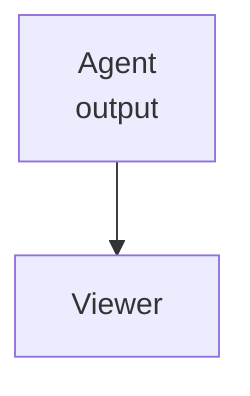

# Agent report

A :rocket: from an agent, with a [site](https://example.com) and a [sibling note](notes.md).

## Tasks

- [x] Parse the file
- [ ] Keep watching while it is rewritten

## Table

| Tool | Status |
| --- | --- |
| cmark | ok |

## Code

```swift
let answer = 42
```

```diff
- old line
+ new line
```

> [!note]
> This callout should pick up GitHub's alert style.

~~removed~~ and inline $e^{i\pi}+1=0$.

\[
\int_0^1 x^2 \, dx
\]

```math
a^2+b^2=c^2
```




` :rocket: ` stays in code, and so does `$not math$` inside `` `$x$` ``.

[[Wikilink]] and @octocat and #123 stay text.
